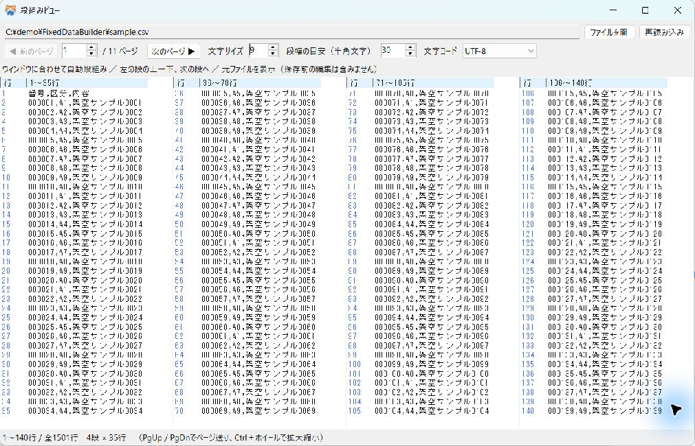
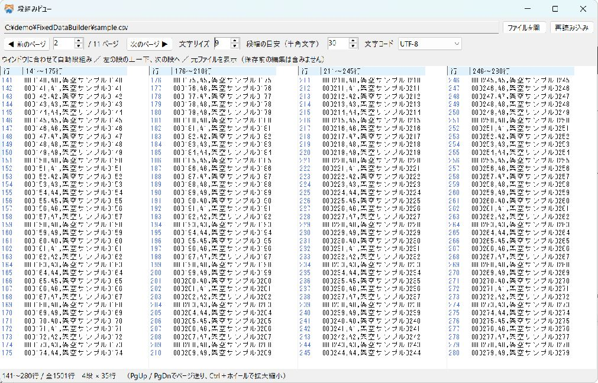

# FixedDataBuilder

固定長データとCSVを、項目の定義に沿って確認・編集するWindowsアプリです。

## ダウンロード

[v1.0.3 軽量版（Windows x64）をダウンロード](https://github.com/konikatsu/FixedDataBuilder/releases/download/v1.0.3/FixedDataBuilder-v1.0.3-win-x64-framework-dependent.zip)

軽量版は.NETを同梱しません。実行するPCに **.NET 8 Windows Desktop Runtime（x64）** が必要です。SDKは不要です。ZIPを展開し、フォルダー内の `FixedDataBuilder.exe` を起動してください。

## データを開く

- 定義はCSVまたはCOBOLコピー句を読み込めます。定義とデータは、どちらを先に選んでもかまいません。
- CSVデータは定義なしでも取り込めます。文字コード・ヘッダーの候補を確認し、自動生成した定義を保存できます。
- 固定長とCSV（ヘッダーあり／なし）の読み込み・保存に対応します。CSVの空白・空欄・先頭ゼロを保持します。
- 文字コードの自動判別候補を初期値として表示し、手動で変更できます。CSVはUTF-8・SJIS・MS932・UTF-16LE・UTF-32LEに対応します。
- 固定長はXと型Nの文字コードを別々に指定できます。型NはSJIS・MS932・UTF-16LE・UTF-32LEに対応します。
- 定義とデータのドラッグ＆ドロップ、定義の再読み込み、全体再読み込み（F5）が使えます。

CSVを定義なしで開いたときは、プレビューとヘッダーの指定を確認し、画面右下の **「この定義で取り込む」** を押すとメイン画面へ反映します。「キャンセル」は取り込まずに閉じます。

v1.0.3では、この取込ボタンが画面下部で隠れる配置を修正しています。利用者によるCSVの取り込み確認済みです。

定義CSVの例：

```csv
項目名,定義,コメント
コード,X(10),入力のコードを保持する
氏名,N(20),氏名を確認する
金額,9(8),ゼロ埋めされた金額
```

`X(n)` は選択した文字コードでnバイト、`N(n)` はn文字の領域です。型NをUTF-32LEにすると通常1文字4バイトになります。数値・符号付き数値・小数・COMP-3にも対応します。定義CSV自体の文字コードは自動判別し、UTF-8・SJIS・MS932で保存できます。[文字コードの説明](docs/character-encodings.md)

## UTF-16LE・UTF-32LEのCSV

CSVの読込条件で **「CSV文字コード」→「UTF-16LE」または「UTF-32LE」** を選べます。**BOMあり・BOMなしの両方**を読み込めます。ヘッダーあり／なし、通常の読込、定義なし読込、入力・出力の比較画面も対象です。

BOMがある場合はその指定を候補にします。BOMなしはバイト列から候補を選びますが、内容によっては判別できないため、プレビューが違う場合は手動で指定してください。BOMと手動指定が異なる場合や、不正なUnicodeの途中切れはエラーで示します。BOMはデータに含めず、先頭ゼロ・前後空白・引用内改行・絵文字を保持します。保存時は選択した文字コードを使い、**BOMなし**で出力します。

起動引数は `--csv-encoding utf16le` / `utf32le`、自動判別は `--csv-encoding auto` です。固定長Xの文字コード指定には影響しません。

UTF-16LE・UTF-32LEのCSV読込はv1.0.2から利用できます。

## 表示・編集

- 横の一覧・縦の一覧・1件表示を切り替えられます。項目番号・属性・位置・コメントを確認できます。
- 定義の項目名・型・長さ・コメントを編集して表示へ適用し、定義CSVとして保存できます。
- 行追加・複製・削除に対応します。セル編集中でないときのCtrl+Deleteで行削除できます。
- 選択項目のHEX、半角・全角スペース数を表示します。下部エリアの高さを変更できます。
- Ctrl＋マウスホイールで拡大・縮小できます。
- 折り返しの対象バイト数・1行のバイト数・表示文字数の上限・列の最小幅を指定できます。固定長は埋め空白も折り返しに含めます。表示上限による省略は「…」で示し、元データ・保存・Excel出力・HEXは保持します。
- 横表示のバイト目盛りと5バイト間隔の縦破線を表示できます。

## 段組みビュー

画面上の **「段組みビュー...」** ボタン、または **「表示 → 段組みビュー...」** から開きます。「ファイルを開く...」でCSV・テキストを選ぶと、左の段の上から下へ、次の段へと原文を並べます。元ファイルの物理的な行を表示し、CSVの引用符・空白・空行を保持します。保存前の編集は含みません。

- **ウィンドウの幅・高さに合わせて、段数と1段の行数を自動調整**します。サイズ変更や文字サイズ変更でも、見ていた先頭行を含むページへ調整します。
- **「前のページ」「次のページ」・ページ番号指定・PgUp/PgDn**でページ送りできます。各段に元の行番号と表示範囲を表示します。
- 「文字サイズ」または **Ctrl＋ホイール**で拡大縮小できます。「段幅の目安（半角文字）」を小さくすると段数を増やせます。
- 長い行は段ごとの横スクロールで確認できます。ビューは読み取り専用です。
- 文字コードはBOMや妥当性から候補を選び、UTF-8・MS932・SJIS・UTF-16LE・UTF-32LEへ手動変更できます。「再読み込み」で変更を取り込みます。64MBまでの文字ファイルが対象です。

段組みビューはv1.0.1から利用できます。

開発中のv1.0.4では、段組みビューの検索欄（**Ctrl+F**）に文字を入力し、**Enter／F3**で次、**Shift+Enter／Shift+F3**で前を検索できます。ファイル全体を対象に、見つかった行のページへ移動して内容を選択します。長い行は該当位置まで横スクロールし、検索結果に行番号・文字位置を表示します。大文字・小文字の区別を切り替えられ、末尾／先頭を越えた場合は折り返したことを表示します。文字位置は.NETのUTF-16単位です。起動確認後に公開予定です。

架空データ1500件と見出し1行を使った、v1.0.3の実画面です。この画面サイズでは、4段・1段35行に自動配置されています。

**1ページ目（1～140行）**



**次のページ（141～280行）**




## 入力と出力の目視比較

「入力・出力を並べて表示...」から比較画面を開き、入力側・出力側でそれぞれ定義とデータを指定します。上下の一覧は独立してスクロールでき、上下を入れ替えられます。マッピングの設定は不要です。

確認済み印・次の未確認への移動・項目名／No.検索が使えます。比較セットにはデータ・定義・読込条件・確認済み印・表示位置などを保存し、保存時の状態から再開できます。比較セットの上限は64MBです。

次の起動方法で比較画面を直接開けます。

```powershell
.\FixedDataBuilder.exe --compare
```

## テストデータとエビデンス

- 正常な基準行を複製し、対象項目と条件を選んでテストデータを生成できます。日付や業務コードの妥当性は利用者が確認してください。
- Excelへ値・項目番号・見出し・コメントを出力できます。保存候補名には元データのファイル名を付けます。
- 一覧の全範囲を画像へ保存・クリップボードへコピーできます。大きい画像の保存は分割します。
- `samples` に架空データと定義の例を同梱しています。

## 検証状況

v1.0.3は警告0・エラー0でビルドし、利用者が製品EXEの起動とCSVの取り込みを確認した同一ファイルを再ビルドせず公開しています。**自動テスト469件は未実行です。** 別PCでの起動・その他の機能の実操作確認は未報告です。

## 開発

C#／Windows Forms／.NET 8。Windows x64を対象としています。

```powershell
dotnet build tests/FixedDataBuilder.Tests/FixedDataBuilder.Tests.csproj -c Release -r win-x64 --no-self-contained
dotnet publish FixedDataBuilder/FixedDataBuilder.csproj -p:PublishProfile=Lightweight -o publish
```

[公開時の確認事項](docs/release-checklist.md)
