# FixedDataBuilder

FixedDataBuilder は、COBOL 固定長データのテストデータを作成・編集するための C# WinForms / .NET 8 ツールです。

定義書 CSV・COBOL コピー句を読み込み、項目とレコードを表形式で見比べながら編集できます。COMP-3 / packed decimal 項目は、画面上では通常の数値として表示・入力し、保存時に packed decimal のバイト列へ変換します。

## ダウンロード

[v0.1.53 軽量版（Windows x64）をダウンロード](https://github.com/konikatsu/FixedDataBuilder/releases/download/v0.1.53/FixedDataBuilder-v0.1.53-win-x64-framework-dependent.zip)

軽量版は.NETを同梱していません。実行するPCに **.NET 8 Windows Desktop Runtime（x64）** が必要です。開発用SDKは不要です。

[v0.1.53 の変更内容](https://github.com/konikatsu/FixedDataBuilder/releases/tag/v0.1.53) ／ [リリース一覧](https://github.com/konikatsu/FixedDataBuilder/releases)

## 選択セルの空白数と拡大・縮小

v0.1.53で、次の機能を追加しました。

- 選択したデータセルの**半角スペース（U+0020）・全角スペース（U+3000）の文字数**を、HEX欄の上へ別々に表示します。CSVは実際の空白だけを数えます。固定長は画面に表示する補完空白も含め、そのうちの補完数を併記します。タブや改行、空白の表示用記号は数えません。
- **Ctrl＋マウスホイール**で表とHEXの文字を同時に拡大・縮小します。上で拡大、下で縮小、通常のホイールはスクロールです。「表示 → 拡大／縮小」でも操作できます。1目盛り1pt、6〜48ptの範囲で調整し、文字サイズを記憶します。
- 拡大・縮小してもデータ・選択セル・未保存状態を維持し、折り返し中の行高と列幅を再計算します。
- BOM付きUTF-8 CSVの先頭が引用符の場合に読込エラーになる不具合も修正しました。ヘッダーあり／なしの両方を対象にしています。

比較には `samples/csv-header-wrap-definition.csv` と、新しい `samples/space-count-data-utf8.csv` をヘッダーあり・UTF-8で使います。1行目の長文セルは半角4文字・全角2文字、2行目は半角6文字・全角0文字です。

全121件の自動テストに成功し、Smart App ControlがONの環境で製品EXEの起動も確認済みです。利用者が起動できたものと同じEXE・DLLを、再ビルドせず配布しています。

## 画面イメージ

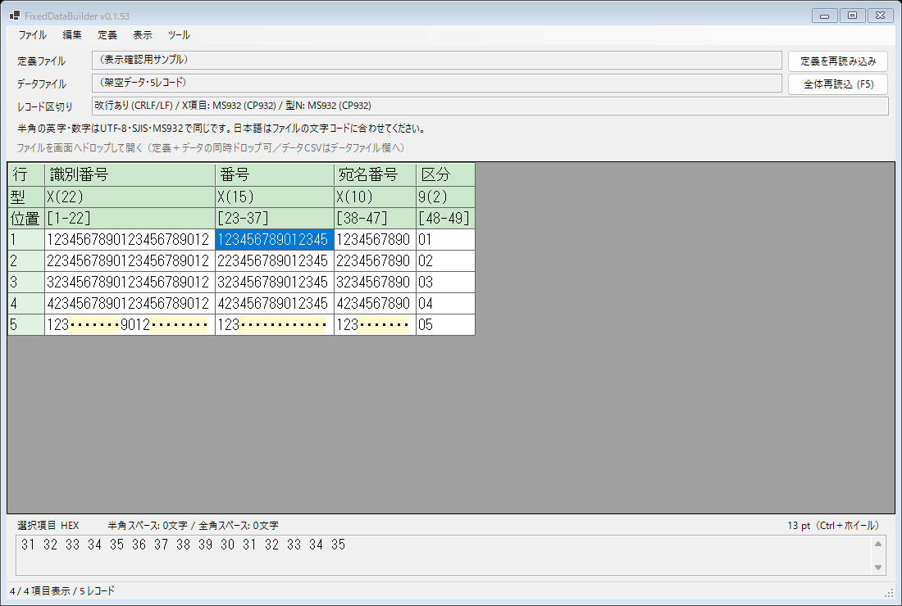

従来と同じ5行の表示確認例で、画面下部に選択セルの空白数と文字サイズを表示しています。

項目縦表示とレコード縦表示を切り替えできます。画面上部には選択中の定義ファイルとデータファイルのパスを表示します。最近使ったファイルは `ファイル` メニューから、定義ファイル・データファイルそれぞれ直近 20 件まで選べます。

文字・数値・見出しは左寄せで表示します。読み込み直後の列幅は、見出しと表示データが収まる幅に自動調整します。空白を示す `･` / `□` も幅に含めます。読み込み後は列の境界をドラッグして手動調整できます。

レコード縦表示の見出しは、**項目名・型・位置をそれぞれ独立した3行**に分けて表示します。たとえば「識別番号」「X(22)」「[1-22]」が別々の行に並び、次の15バイトの項目の位置は `[23-37]` です。位置は1始まりのバイト位置です。見出しは編集できず、縦にスクロールしても表示を維持します。CSVの位置行には `CSV列1` などの列番号を表示します。

データの左端は `1`、`2`、`3`…の行番号です。型・位置の見出し行はデータ件数に含めません。データ読込プレビューも「行」と番号だけの表示です。

## バイト数による折り返し表示

`表示 → 折り返し表示` にチェックを入れると、長い値を複数行で表示します。`表示 → 折り返し表示設定...` では、チェックに加え、**対象にする長さ（何バイト以上）**と**1行の長さ（何バイトごと）**を別々に指定できます。初期値は20バイト以上・20バイトごとです。

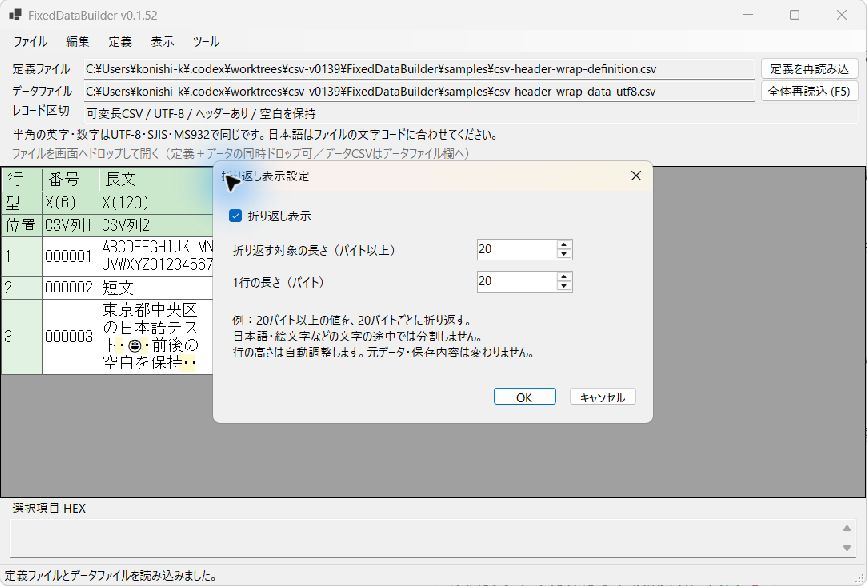

たとえば半角英数字40文字を20バイトで折り返すと2段、10バイトなら4段です。**グリッドの行の高さも表示段数に合わせて自動調整**し、短い値は1段のままです。チェックを外すと通常の1行表示の高さに戻ります。項目縦・レコード縦の両方に対応します。

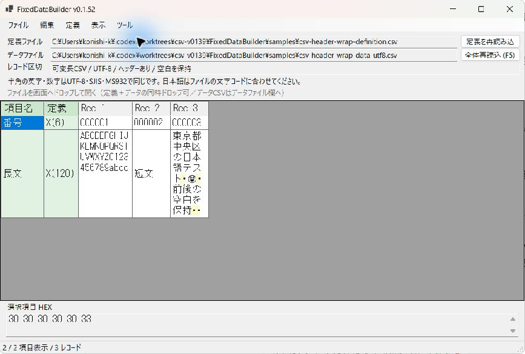

選択中のCSV文字コード、固定長X文字コード、型N文字コードでバイト数を数えます。日本語・絵文字・結合文字の途中では分割しません。1文字のバイト数が設定幅を超える場合は、その文字を分割せず1行に表示します。CSV内の既存の改行も、チェック中は段として表示します。

折り返しはメイン画面の表示だけです。編集欄では元の値を扱い、保存データ・Excel出力・HEXへ表示用の改行を追加しません。固定長の補完空白の記号も折り返して表示します。折り返し条件は、その起動中の表示設定として保持します。

## 文字コードの説明

**半角の英字・数字は、UTF-8・SJIS・MS932で同じです。** たとえば `ABC123` は同じバイト列になります。

文字コードはファイルの作成元に合わせて選んでください。CSVは `UTF-8` / `MS932 (CP932)` / `SJIS (JIS X 0208)`、固定長はX文字コードと型N文字コードをそれぞれ選択できます。

| 選択 | 扱う文字 | 例 |
| --- | --- | --- |
| SJIS (JIS X 0208) | ASCII・半角カナ・JIS X 0208。拡張文字はエラー | 東京、ｶﾅ、波ダッシュ `〜` |
| MS932 (CP932) | Windowsの拡張文字を含む文字コード | `①`・`髙`・`﨑`、全角チルダ `～` |
| UTF-8 | Unicodeの文字 | 他の文字コードで表現できない文字を含むデータ |

**以前の「Shift_JIS」指定はMS932相当です。** 記憶済みの条件はMS932として引き継ぐため、従来のファイルを開く際は `MS932 (CP932)` を選んでください。新しいSJISは拡張文字・外字や不正なバイトを拒否し、保存時に表現できない文字があれば保存先を変更せずエラーにします。

SJISとMS932では、波ダッシュ `〜` / 全角チルダ `～` など、一部の記号のUnicodeへの対応も異なります。[詳しい変換規則](docs/character-encodings.md)を参照してください。

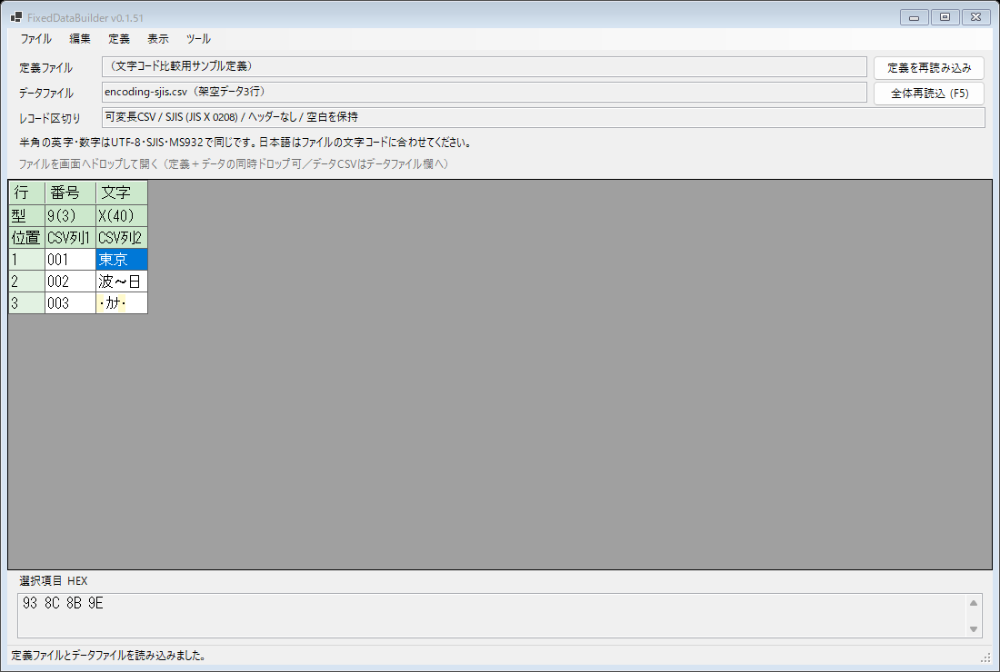

試す場合は `samples/encoding-comparison-definition.csv` を開き、`encoding-sjis.csv` はSJIS、`encoding-ms932.csv` はMS932で読み込んでください。後者をSJISで開くと拡張文字のエラーを確認できます。

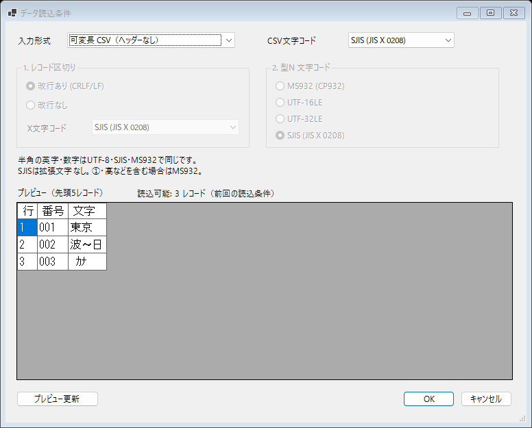

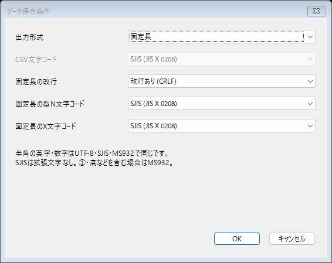

## 未保存の変更

セルを編集したり、データ行を追加・複製・削除すると、タイトルに **【未保存】** と表示します。保存が成功すると表示が消えます。保存や再読み込みに失敗した場合は、未保存の状態を保持します。

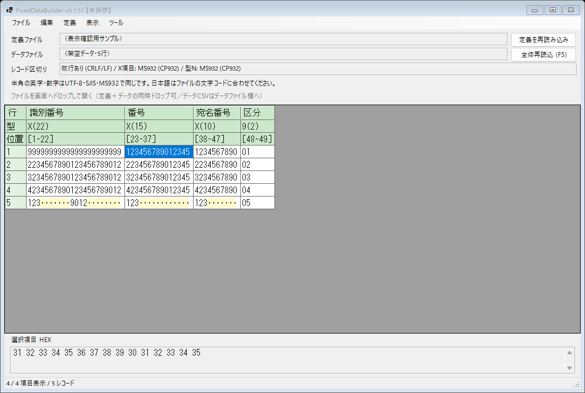

終了、別ファイルへの切り替え、全体再読込などで未保存の変更がある場合は、「保存して続ける」「保存せずに続ける」「キャンセル」を選べます。保存を取り消したり保存に失敗した場合は、元の編集画面に戻ります。

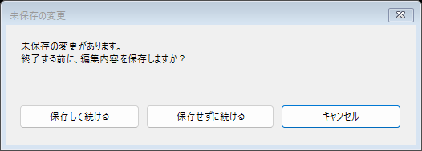

## 読込条件の記憶

同じ定義とデータを開いたとき、前回正常に読み込めた条件を初期表示します。アプリを開き直しても、固定長／CSVの形式、CSV文字コード・ヘッダー有無、固定長の改行区切り・X文字コード・型N文字コードを引き継ぎます。プレビューに「前回の読込条件」と表示し、必要なら条件を変更できます。

条件はこのPCに最大100組記憶します。読込をキャンセルした場合や読み込みに失敗した場合は、前回の条件を上書きしません。名前を付けて保存した場合は、その保存先と形式も記憶します。


## 再読み込み

- **「定義を再読み込み」**：定義ファイルだけを読み直し、表示中のデータと未保存の状態を保持します。項目名の変更などを反映できます。データを読み込んでいない状態なら、項目の追加なども反映します。
- **「全体再読込 (F5)」**、`ファイル → 再読み込み`、または **F5**：現在の定義とデータを、形式・文字コード・改行条件を引き継いで読み直します。Excel取込後でデータをまだ保存していない場合は元のExcelを、名前を付けて保存した後はその保存先を読み直します。

定義だけの再読み込みで項目数・順序・型・桁数などが変わっている場合は、データを勝手に読み替えず案内を表示します。編集内容を保存したうえで全体再読込を使い、定義とデータを合わせて読み直してください。

全体再読込は、未保存の変更がなければ確認なしで実行します。読み込みに失敗した場合は現在の内容を保持します。表示方向は維持し、定義構造が同じ場合は非表示項目の選択も維持します。

## ドラッグ＆ドロップで開く

エクスプローラーから、ファイルを画面上の表やファイル欄へドラッグ＆ドロップして開けます。

- 定義 CSV（`.csv`）や COBOL コピー句（`.cbl` / `.cpy` / `.cob`）は、定義として読み込みます。
- 固定長データは、先に定義を開いてからドロップします。通常のメニュー操作と同じ `データ読込条件` 画面で、改行区切り・型N文字コード・プレビューを確認できます。
- 定義1件と固定長データ1件をまとめてドロップすると、定義、データの順に読み込みます。選択順は問いません。
- データの拡張子が `.csv` の場合は、画面上部の `データファイル` 欄へ単独でドロップしてください。拡張子から判定できない定義は `定義ファイル` 欄へドロップできます。
- FixedDataBuilder が出力した Excel（`.xlsx`）も、単独でドロップして取り込めます。

フォルダー、3件以上のファイル、定義同士・データ同士など種類を判別できない組み合わせは受け付けません。定義とデータが両方 `.csv` の場合は、対応するファイル欄へ1件ずつドロップしてください。

## 可変長 CSV データの読み込み・保存

1. データの列順に並んだ定義書 CSV または COBOL コピー句を開きます。
2. `ファイル → データ読込` から CSV データを選びます。ドロップする場合は、画面上部の `データファイル` 欄へ置いてください。
3. `データ読込条件` の入力形式を `可変長 CSV（ヘッダーなし）` または `可変長 CSV（ヘッダーあり）` にし、CSV文字コードを `UTF-8` / `SJIS (JIS X 0208)` / `MS932 (CP932)` から選びます。`.csv` を選んだ場合は CSV が初期選択されます。
4. プレビューを確認して `OK` を押します。

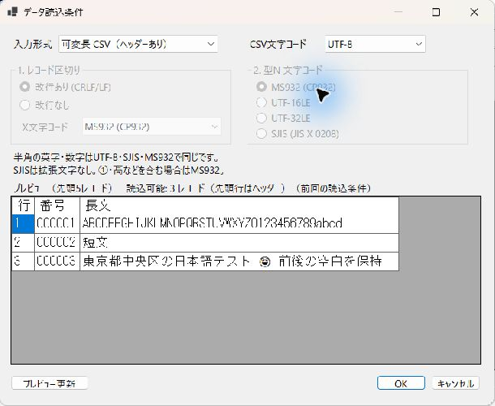

ヘッダーなしは先頭行からデータとして読みます。ヘッダーありは、最初のCSVレコードを見出しとして除外し、次のレコードからデータとして読みます。引用符内に改行がある見出しも、1つのヘッダーレコードとして扱います。ヘッダーを除いたデータ行番号は1からです。どちらもCSVの1列目から定義の項目順に対応させ、見出しの名前による並べ替えは行いません。ヘッダーの列数も定義と照合します。空ファイルやヘッダーだけでデータ行のないファイルはエラーにします。カンマ区切り、CRLF / LF、引用符 `"..."`、引用符内のカンマ・改行、`""` で表す引用符、空欄・末尾の空欄、UTF-8のBOMあり・なしに対応します。

CSVでは空欄、前後の半角・全角空白、数値の先頭ゼロをそのまま表示・保存します。桁合わせの空白追加・ゼロ埋め・空白の削除はしません。空欄 `""` と空白1文字 `" "` は別の値です。実際に含まれる空白だけを `･` / `□` で表示し、レコード縦表示の見出しにはバイト位置に代えて `CSV列1` などの列番号を表示します。

CSVで行を追加した場合も、表示項目の初期値は空欄です。型Nの全角空白埋めや数値のゼロ初期値は、固定長モードだけで使用します。

列数が定義と一致しない行や、閉じていない引用符、不正な文字コードはエラーにします。REDEFINES項目はCSVの列として数えません。ヘッダー有無は明示的に選び、自動判定や列名による並べ替えは行いません。以前の読込条件はヘッダーなしとして引き継ぎます。拡張子が `.csv` の固定長データは、入力形式を `固定長` に切り替えて読み込めます。

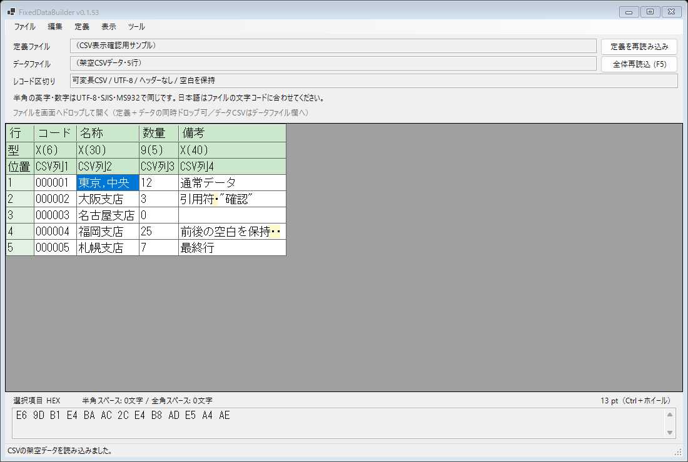

`ファイル → 名前を付けて保存` の `データ保存条件` で、出力形式を `固定長` / `可変長 CSV（ヘッダーなし）` / `可変長 CSV（ヘッダーあり）` から選べます。読み込んだ形式が初期選択されます。`上書き保存` は現在の形式・文字コードを維持します。

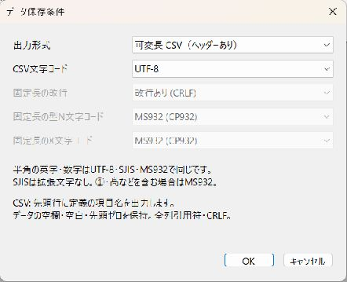

ヘッダーありで保存する場合は、**定義の物理項目順に項目名を先頭行へ出力**します。入力CSVの元のヘッダー名は保存しません。REDEFINESは見出し・データの両方で列から除外します。ヘッダー有無は記憶・上書き保存・F5にも引き継ぎます。

CSV保存は全列を引用符で囲み、引用符を `""` に変換し、CRLFで改行します。UTF-8はBOMなし、SJIS・MS932も選べます。CSVの値は保持しますが、引用符や改行の書き方まで入力ファイルと同一になるわけではありません。選択した文字コードで表現できない文字はエラーにし、既存の出力先を変更しません。非表示項目も出力します。

固定長を選んだ場合は、従来どおり定義桁数を検証し、空白・ゼロで補完して保存します。CSVモードでは固定長の桁数検証を適用しません。CSVと固定長の相互変換も保存時に選べます。固定長出力のX文字コードは定義ごとの従来値を初期表示し、保存条件でSJIS・MS932・UTF-8に切り替えられます。CSV文字コードと型N文字コードは独立しています。

同梱の `samples/csv-import-definition.csv` と `samples/csv-import-data-utf8.csv`（ヘッダーなし）、`samples/csv-import-data-with-header-utf8.csv`（ヘッダーあり）で試せます。折り返しを試す場合は `samples/csv-header-wrap-definition.csv` と `samples/csv-header-wrap-data-utf8.csv` をヘッダーあり・UTF-8で開いてください。

## Excel出力

Excel出力の既定ファイル名には、現在のデータファイル名（拡張子を除く）を先頭に付けます。たとえば `入力データ.csv` のレコード縦出力は `入力データ_FixedDataBuilder_レコード縦.xlsx`、項目縦出力は `入力データ_FixedDataBuilder_項目縦.xlsx` です。保存ダイアログで名前を変更できます。定義だけを開いてデータを作成した場合は、定義ファイル名を使います。

Excelへ出力した見出し・行番号・項目名・定義欄は、水色のベタ塗りで表示します。レコード縦・項目縦の両方に適用し、データ部分は白背景です。

レコード縦のExcel出力も、1行目が項目名、2行目が型、3行目が位置です。3行とも水色の見出しとし、4行目からデータを出力します。新しい3行形式に加え、以前の1セル内で改行した見出しや2行形式のExcelも取り込めます。以下はv0.1.40時点の配色例です。

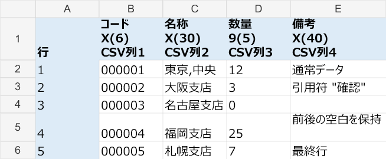

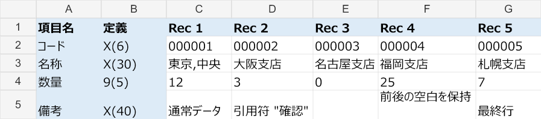

変更は新しく出力するExcelに反映されます。以前に出力したファイルは、再度Excel出力してください。

## 配布形式・動作確認

最新版 **v0.1.53** では、選択セルの半角・全角スペース数表示と、Ctrl＋ホイールによる拡大・縮小を追加しました。BOM付きUTF-8 CSVの先頭が引用符の場合の読込も修正しました。ヘッダーありCSV、折り返しと自動行高、SJIS／MS932の個別選択も引き継ぎます。

今後の配布は軽量版に統一します。公開する軽量版は、Smart App ControlがONの環境で製品EXEからメイン画面が開くことを確認したファイルです。ダウンロード後の別PCでの起動確認は、利用者側で行います。

v0.1.53は警告0・エラー0でビルドし、全121件の自動テストに成功しました。ヘッダー・BOM・文字コード、折り返し、空白数、Ctrlホイールの振り分け、通常のスクロール経路、文字サイズの記憶、データと選択の保持を確認しています。テスト側と配布DLLのSHA256一致、SAC ONでの製品EXE起動、PC側.NET8.0.32の使用も確認しました。初回の拒否後にファイルを再ビルドせず、同じファイルで利用者の起動確認とこちらのテスト・製品起動に成功しています。

zip を展開して `FixedDataBuilder.exe` を実行してください。zip には `samples/` 配下のサンプル定義・サンプルデータも同梱しています。

## 定義書 CSV / COBOL コピー句

UTF-8 CSV を想定しています。基本形式は `項目名,定義` の 2 列です。

```csv
項目名,定義
名前,N(10)
英名,X(10)
年齢,9(2V1)
体重,S9(3V2)
攻撃力,S9(9) COMP-3
```

COBOL コピー句（`.cbl` / `.cpy`）も定義ファイルとして読み込めます。コピー句ファイルは UTF-8、固定形式の 7 桁目ルールありとして扱います。選択ボタンからコピー句を選ぶと、PIC 句付きの項目を表へ表示します。


```cobol
       01 SAMPLE-RECORD.
          05 名前       PIC N(10).
          05 英名       PIC X(10).
          05 年齢       PIC 9(2)V9(1).
          05 体重       PIC S9(3)V9(2).
          05 攻撃力     PIC S9(9) COMP-3.
```

コピー句読み込みの初期対応範囲:

- `PIC X(n)` / `PIC N(n)`
- `PIC XXXXXX` / `PIC 999V99` のような括弧なし表記
- `PIC 9(n)` / `PIC S9(n)`
- `PIC 9(n)V9(m)` / `PIC S9(n)V9(m)`
- `COMP-3` / `PACKED-DECIMAL`
- 同一 PIC 行の基本項目 `OCCURS n TIMES`
- 集団項目 `OCCURS n TIMES` の限定対応
- `REDEFINES` 配下の `OCCURS`、多重 `OCCURS`、`OCCURS DEPENDING ON` は未対応です
- `REDEFINES` は物理レコード長には加算せず、保存時は重複領域として書き出しません。画面の表示対象からは除外します
- 66 レベル、88 レベルは固定長データ項目ではないため読み飛ばします
- 英字の COBOL 項目名は内蔵辞書で可能な範囲だけ日本語表示名に変換します
- コピー句由来のデータ読み込みでは、X/9/S9は既定UTF-8で、読込条件のX文字コードで変更できます。N項目は別に選択した文字コード、COMP-3はバイナリとして読み込みます

対応している COBOL 表記:

- `9(n)`: 符号なし数字
- `S9(n)`: 符号付き数字
- `9(nVm)`: 小数桁付き符号なし数字
- `S9(nVm)`: 小数桁付き符号付き数字
- `X(n)`: 文字項目、選択した文字コードの n バイト領域
- `N(n)`: 全角文字、全角 n 文字領域
- `9(n) COMP-3`: 符号なし packed decimal
- `S9(n) COMP-3`: 符号付き packed decimal

## できること

- 定義書 CSV 読み込み
- 定義書 CSV 作成
- 定義書 CSV 作成時の型選択
- 定義書 CSV 作成時、文字型の小数桁は入力不可
- `定義作成` は空の新規作成、`定義修正` は読み込み済み定義の編集
- 固定長データ読み込み
- 可変長 CSV データの読み込み・保存（定義の項目順、ヘッダーあり／なし、UTF-8 / SJIS / MS932、空白を保持）
- 定義・データ・Excel のドラッグ＆ドロップ読み込みと、定義＋データの同時ドロップ
- 読み込み時の改行あり / 改行なしと型N文字コード選択。`データ読込条件` 画面で、`MS932 (CP932)` / `SJIS (JIS X 0208)` / `UTF-16LE` / `UTF-32LE` を選べます。型Nの既定値は従来と同じMS932です
- `データ読込条件` 画面で、選択中の条件によるデータプレビューを確認できます


- 保存時に読み込み時の改行形式を継承
- 上書き保存 / 名前を付けて保存
- 項目縦表示 / レコード縦表示の切り替え
- `項目表示` から、画面に表示する項目を選択できます。非表示にした項目も内部データとしては保持され、保存時のレコード構造からは除外されません
- レコード縦表示時の項目ヘッダーにバイト位置ルーラを表示
- OCCURS 展開項目は、項目縦表示ではグループ見出し行、レコード縦表示では OCCURS 専用行の帯表示でまとまりを表示
- レコード追加、複製、削除
- セル編集
- 表とHEX表示のフォント名・サイズ設定と記憶
- 初期フォントは `MS ゴシック 12pt`
- 数値のゼロ埋め表示
- 符号付き数値の符号表示
- 文字項目で半角スペース・全角スペース・埋めスペースを `･` / `□` で表示し、空白部分だけを薄黄色で表示
- 型・桁数の簡易検証
- 検証エラーセルの薄赤表示
- バイト数を指定した表示の折り返し、折り返し段数に合わせた行高の自動調整
- 選択項目の HEX 表示
- 画面表示形式の Excel 出力
- Excel 出力後に作成したブックを開く
- FixedDataBuilder が出力した Excel の取り込み
- SJIS / MS932 / UTF-8 を選べる固定長データ保存
- `N(n)` の未入力値は全角スペースで保存
- `S9(n)` / `S9(nVm)` の表示数値は末尾桁の ASCII ゾーン符号で保存
- COMP-3 / packed decimal の暫定エンコード・デコード

COMP-3 / packed decimal は、現時点では以下の符号ニブルを前提にしています。

```text
符号付き正数: C
符号付き負数: D
符号なし: F
```

例:

```text
S9(3) COMP-3  +123 -> 12 3C
S9(3) COMP-3  -123 -> 12 3D
9(3)  COMP-3   123 -> 12 3F
```

## サンプル

サンプルは、定義ファイルとデータファイルの先頭名をなるべくそろえています。

### CSV 定義サンプル

まずは `samples/basic-definition.csv` と `samples/basic-data-sjis-crlf.dat` を読み込んでください。MS932（以前のShift_JIS指定）前提、改行ありの固定長データです。

```csv
ジナン,JINAN,7,6.7,100
キナコ,KINAKO,3,3.8,50
オジュン,OJUN,18,45.1,-9999
```

攻撃力は `S9(9) COMP-3` の packed decimal としてデータファイルに格納しています。旧名の `definition.csv`、`sample.dat`、`sample-shiftjis.dat` も互換用に残しています。

### COBOL コピー句サンプル

コピー句サンプルは、定義ファイル名とデータファイル名の先頭をそろえています。データファイル名の末尾は読み込み条件を表します。

- コピー句ファイルは UTF-8 です
- データファイル名の `crlf` は `改行あり (CRLF/LF)`、`none` は `改行なし` を表します
- データファイル名の `n-utf16le` / `n-utf32le` / `n-sjis` は、型N文字コードの選択値を表します（既存の `n-sjis` サンプルはMS932を選択）
- 型Nは固定長領域として扱うため、可変長のUTF-8は選択肢から外しています
- 以下の表にない組み合わせは、エラーまたは文字化けになります

| 用途 | 定義ファイル | データファイル | 改行区切り | 型N文字コード |
| --- | --- | --- | --- | --- |
| 基本コピー句 | `copybook-basic-definition.cbl` | `copybook-basic-data-crlf-utf8-n-utf16le.dat` | 改行あり (CRLF/LF) | UTF-16LE |
| 基本コピー句 | `copybook-basic-definition.cbl` | `copybook-basic-data-none-sjis-n-sjis.dat` | 改行なし | MS932 (CP932) |
| 基本コピー句 | `copybook-basic-definition.cbl` | `copybook-basic-data-none-utf8-n-utf16le.dat` | 改行なし | UTF-16LE |
| 基本コピー句 | `copybook-basic-definition.cbl` | `copybook-basic-data-none-utf8-n-utf32le.dat` | 改行なし | UTF-32LE |
| 基本項目OCCURS | `copybook-occurs-definition.cbl` | `copybook-occurs-data-crlf-utf8-n-utf16le.dat` | 改行あり (CRLF/LF) | UTF-16LE |
| 集団項目OCCURS | `copybook-group-occurs-definition.cbl` | `copybook-group-occurs-data-crlf-utf8-n-utf16le.dat` | 改行あり (CRLF/LF) | UTF-16LE |

基本コピー句サンプルでは、顧客名、英名、年齢、金額の 3 レコードを確認できます。金額は `S9(9) COMP-3` の packed decimal で、3 レコード目は `-9999` です。

基本項目OCCURSサンプルでは、以下のように PIC 付き項目に直接指定された `OCCURS` を展開します。

```cobol
05 ITEM-CODE  PIC X(4) OCCURS 3 TIMES.
05 ITEM-COUNT PIC 9(3) OCCURS 3 TIMES.
```

集団項目OCCURSサンプルでは、以下のように集団項目の配下にあるPIC付き項目を回数分展開します。

```cobol
05 DETAIL OCCURS 3 TIMES.
   10 PRODUCT-CODE PIC X(4).
   10 QUANTITY     PIC 9(3).
```

画面上では、たとえば以下のような項目名になります。

```text
明細-1.商品コード
明細-1.数量
明細-2.商品コード
明細-2.数量
明細-3.商品コード
明細-3.数量
```

項目縦表示では `明細-1` / `明細-2` のような見出し行を挟み、レコード縦表示では OCCURS 専用行でグループごとの帯を表示します。データセルの背景は通常色のままにして、値を読み取りやすくしています。


`REDEFINES` 配下の `OCCURS`、多重 `OCCURS`、`OCCURS DEPENDING ON` は現時点では未対応です。

旧名の `definition-english.cbl`、`sample-copybook-*.dat` も互換用に残しています。

## ビルド済み exe

`release/FixedDataBuilder.exe` に Release ビルド済みの実行ファイルを配置しています。

## 今後の対応予定

- 定義書フォーマットの追加対応
- COMP-3 / packed decimal の詳細ルール設定
  - 符号ニブルを環境に合わせて選択できるようにする
    - 例: 正数を `C`、負数を `D`、符号なしを `F` として保存する
    - 例: 符号なし COMP-3 でも末尾ニブルを `F` にするか、別のルールにするかを選べるようにする
  - 桁数とバイト数の扱いを画面で確認できるようにする
    - 例: `S9(9) COMP-3` が 5 バイトになることを表示する
    - 例: 奇数桁 / 偶数桁で先頭 0 を補うかどうかを確認できるようにする
  - 小数桁付き COMP-3 の端数処理を選択できるようにする
    - 例: `S9(3V2) COMP-3` に `12.345` を入れたとき、エラーにする / 四捨五入する / 切り捨てる、を選べるようにする
  - 読み込んだバイト列と画面表示値の対応を確認しやすくする
    - 例: packed decimal の元バイト、符号ニブル、画面上の数値を並べて確認できるようにする
- HEX 表示の編集支援
- 検証内容の拡充
